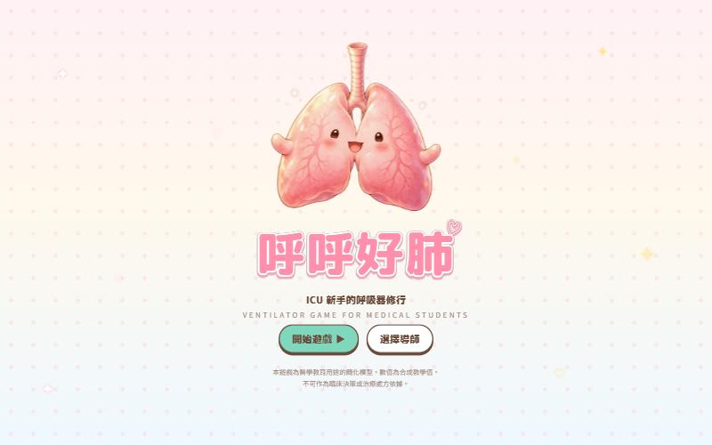
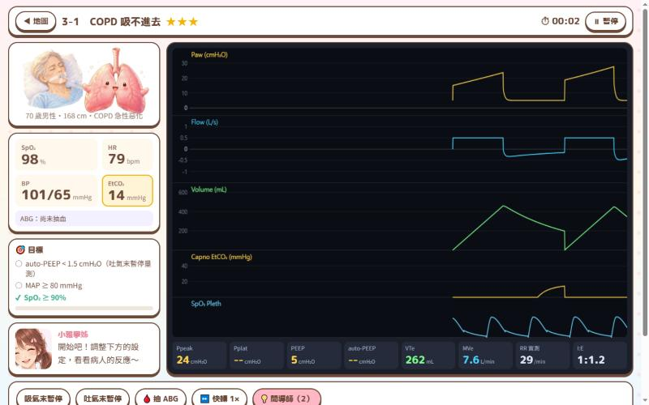
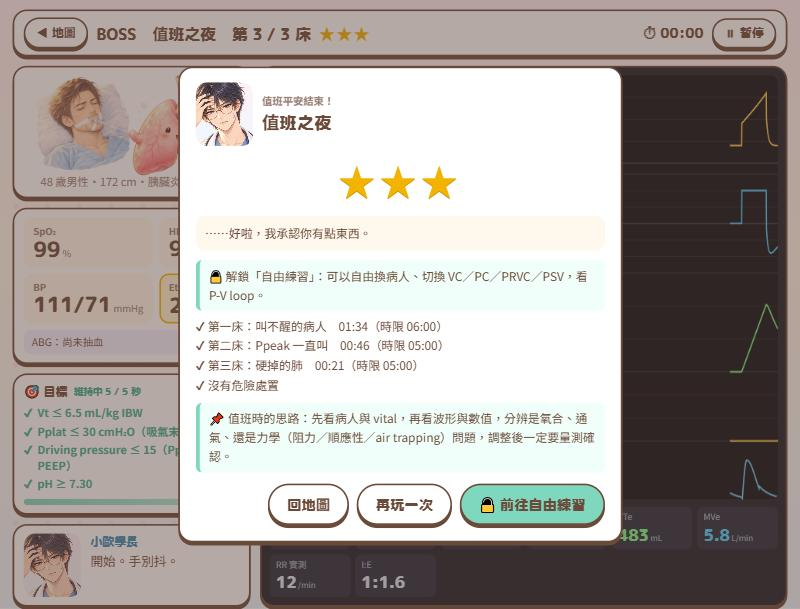

# 呼呼好肺 — ICU 新手的呼吸器修行

給醫學生玩的呼吸器互動遊戲。你是剛到 ICU 的實習醫師，在導師帶領下處理插管病人：
從基本設定、氧合與通氣，到 Air trapping 與 ARDS 肺保護通氣。

**▶ 立即遊玩：<https://ychjam.github.io/huhu-lung/>**（桌機與手機瀏覽器皆可）

## 特色

- **真的肺力學模型**：每個病人都由肺力學引擎（非線性順應性、氣道阻力、auto-PEEP、病人自主呼吸）
  與生理模型（氣體交換、分流、死腔、心血管）即時計算。調對設定，波形和生命徵象自然會好轉——過關條件不是寫死的數字。
- **像真的呼吸器一樣操作**：Plateau 與 auto-PEEP 必須親手按「吸氣末／吐氣末暫停」量測；改了設定就要重量。
- **兩位導師**：溫柔鼓勵的小雅學姊、毒舌吐槽的小歐學長，劇情與醫學內容相同、只差語氣。
- **單一 `index.html`**：不需安裝、不需伺服器，CSS、JavaScript、角色插圖全部內嵌。

## 關卡

| 章 | 關卡 | 學什麼 |
|---|---|---|
| 1 新手村 | 1-1 第一次上機 | Vt 依理想體重（IBW）6–8 mL/kg，調降不必要的高氧 |
|  | 1-2 氧合不好怎麼辦 | 分流造成的低血氧：光加 FiO₂ 不夠，要用 PEEP 撐開肺泡 |
|  | 1-3 CO₂ 太高 | PaCO₂ 由肺泡通氣量決定，用 RR 調整 |
| 3 吐不完的氣 | 3-1 COPD 吸不進去 | Air trapping 與 auto-PEEP；dynamic hyperinflation 造成低血壓 |
|  | 3-2 氣喘重積 | Ppeak 高但 Pplat 不高＝阻力問題；permissive hypercapnia |
| 4 硬掉的肺 | 4-1 肺保護通氣 | Vt 6 mL/kg IBW、Pplat ≤ 30、Driving pressure ≤ 15 |
|  | 4-2 找最佳 PEEP | 逐格量 Pplat，找 driving pressure 最低的 PEEP |
| BOSS | 值班之夜 | 從各章隨機抽三床變化版病人，沒有提示 |

打倒 Boss 解鎖 **自由練習**：自由換病人組套、切換 VC／PC／PRVC／PSV、觀察 P-V／F-V loop。

## 怎麼玩

1. 選一位導師，聽完病例簡報（部分關卡有小考）。
2. 用下方的 −／＋ 旋鈕調整呼吸器；目標清單會即時打勾，**全部同時維持數秒**就過關。
3. 善用工具：吸氣末／吐氣末暫停（量 Pplat、auto-PEEP）、🩸 抽 ABG、⏩ 快轉（CO₂ 變化本來就慢）。
4. 星等：★ 過關 ／ ★★ 時限內且沒有危險處置 ／ ★★★ 再加上沒用提示、小考答對。
5. SpO₂ < 80% 或 MAP < 55 持續 20 秒，導師會接手，可以重來。

進度存在瀏覽器（localStorage）；無痕模式也能玩，只是不會記住。

## 製作過程（Vibe Coding 作業）

1. **規格書**：和 AI 討論想法，整理成 [`SPEC.md`](SPEC.md)（目標、關卡、評分、美術、技術、里程碑）。
2. **Vibe Coding**：以 Claude Code 依規格分階段實作（M1 骨架 → M2 第一關 → M4 全關卡 → M5 Boss 與沙盒）；
   每關門檻都先用模型實跑校準，並以自動化測試驗證「正確解法能過關、常見錯誤不能過關」。
3. **美術**：角色插圖由 OpenAI Codex 的 image generation 依美術規範繪製（溫暖繪本感 JRPG 立繪風格，所有角色皆為原創）。
4. **發布**：整理成單一 `index.html`，以 GitHub Pages 公開。

肺力學與生理引擎沿用作者自製的「虛擬呼吸器」教學模擬器。

## 醫學內容依據

關卡中的數值目標參考下列文獻的方向；病人參數為**合成的教學值**，不是診斷門檻或治療處方。

- ARDS Network. Ventilation with lower tidal volumes as compared with traditional tidal volumes for acute lung injury and ARDS. *N Engl J Med* 2000;342:1301–8.
- Amato MBP, et al. Driving pressure and survival in the acute respiratory distress syndrome. *N Engl J Med* 2015;372:747–55.
- ATS/ESICM/SCCM Clinical Practice Guideline: Mechanical Ventilation in Adult Patients with ARDS (2017) 及後續更新。
- Global Initiative for Chronic Obstructive Lung Disease (GOLD) Report.

## 免責聲明

本遊戲為**醫學教育用途的簡化模型**，模型為單一肺單元近似，未模擬局部肺異質性、代謝代償等許多臨床因素。
**不可作為臨床決策或治療處方依據。**
